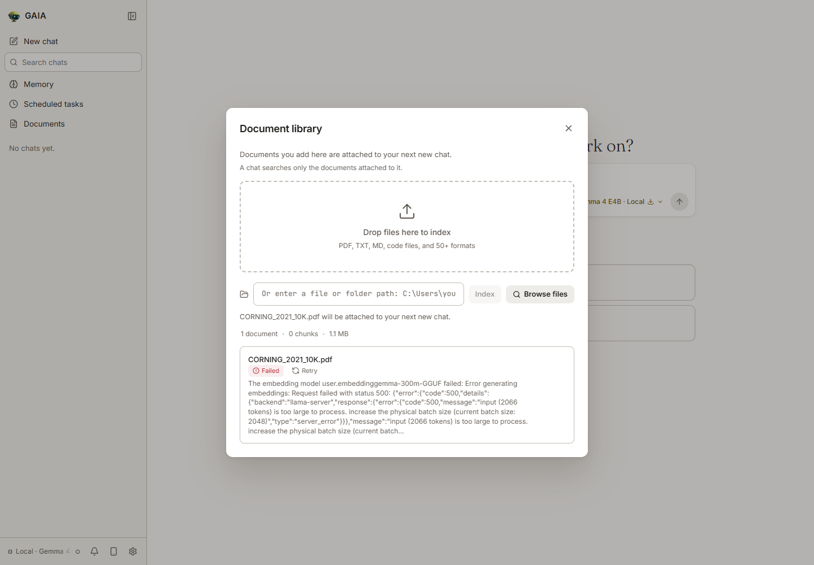
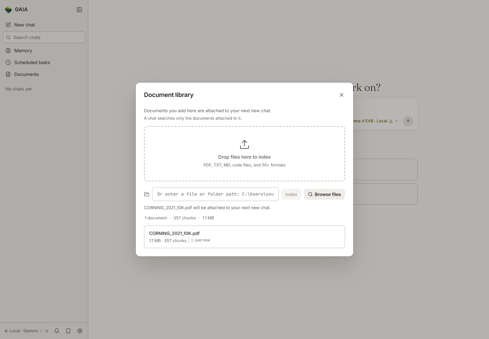
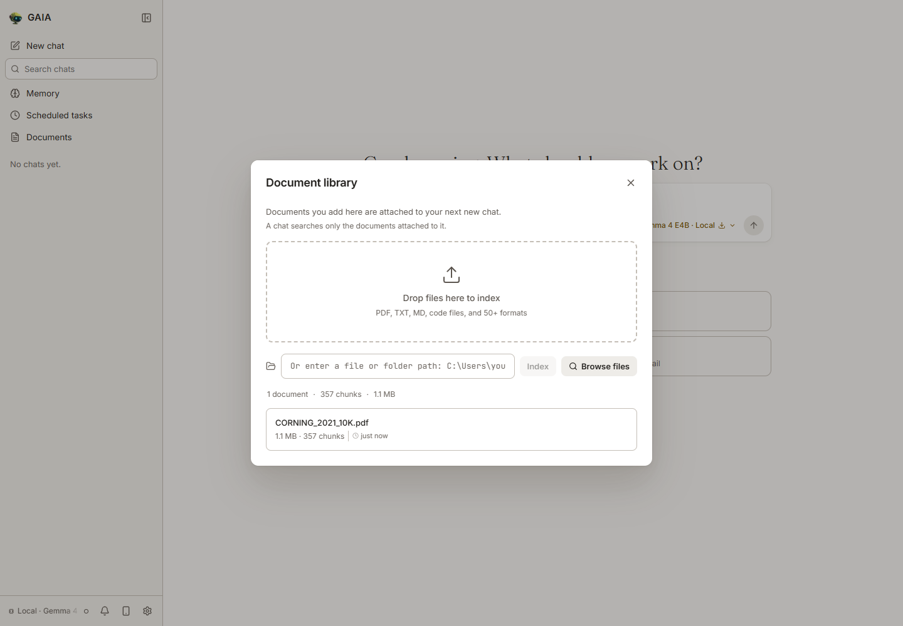

# Dense no-break-space RAG indexing proof

Issue: https://github.com/amd/gaia/issues/5547

- Baseline: `82ad2a771c7ed5b6b26f4521b3e4eaad40820f85`
- Candidate: `cd3dcaeb1a0d31d605e5b1db782286b877804a68`
- Production change: replace U+00A0 with ordinary spaces in outbound embedding inputs. Stored chunks, extracted text, source positions, cache keys and the 2,000-character cap remain unchanged.
- Exact source digests, commands, JUnit outcomes and skip reasons: [manifest.json](manifest.json).

## Real document and model

The unmodified 125-page Corning 2021 10-K comes from the FinanceBench source URL already pinned by GAIA:

https://raw.githubusercontent.com/patronus-ai/financebench/cc39aeb4afdf33909ee1412188bf89035950c2eb/pdfs/CORNING_2021_10K.pdf

PDF SHA-256: `8023fac91ad417f996b692c506ee0e097effd091e698275288e4126cb8a2020e` (1,131,912 bytes). The PDF and downloaded model are not redistributed here.

Windows 11 build26200; native Python3.12.13; Docker Linux Python3.12.14. A dedicated local Lemonade2026.43.3 embeddable server ran on loopback13355 with llama.cpp b11393 CPU (`-t4`), default `user.embeddinggemma-300m-GGUF`, checkpoint `ggml-org/embeddinggemma-300M-GGUF:Q8_0`, ubatch2048. No model responses, embeddings or extraction were mocked. No paid inference or judge was used.

The native `RAGSDK.index_document()` replay used `use_vlm=False`, `use_llm_chunking=False`, the same input, model and isolated configuration on both revisions:

| Result | Baseline | Candidate |
|---|---|---|
| Extracted text/chunks | 439,494 chars /357 chunks | 439,494 chars /357 chunks |
| Real embedding | HTTP500:2066 tokens exceed2048 | All357 vectors indexed |
| Final SDK result | `embedding_unavailable`,0 indexed chunks | `success=True`,357 indexed chunks |
| Original text | Index cannot complete | Stored chunks retain64,306 U+00A0 characters |

See `baseline-index.log/.json`, `candidate-index.log/.json`, and the executable [index_probe.py](index_probe.py). Windows raw-source hashes differ from Git LF hashes only by line endings; the LF candidate SDK hash is `83a85263f04f8f5e3390d1f218ce43913fbc58554c2f1ef00155d626698cb834`.

## Actual Agent UI

The browser used the real `gaia chat --ui` entry, document library's path-index action, real HTTP router, RAGSDK and local embedding server. Before and after used separate isolated state directories. The original failed document remains failed after refresh/restart; the candidate remains complete with357 chunks after refresh. `baseline-documents.json` and `candidate-documents.json` contain actual HTTP200 GET responses from `/api/documents`.





UI setup boundary: the dev sidecar was selected with an isolated `.installed` receipt fixture. The existing setup-check request was continued to the real server with its supported `skip_chat_model=true` query parameter; no response body was fabricated. This isolates document indexing without downloading an unrelated6GB chat model. The real UI displays that chat model as not downloaded. The existing frontend build is from the unchanged82ad source. The TCP forwarder only transports bytes to the real loopback-bound UI. Scripts `launch_ui.py`, `forward_ui.py`, and `scope_browser.js` show this setup. No chat answer generation, VLM extraction, binary installer certification or GPU evaluation is claimed.

## Regression and project checks

| Check | Observed result |
|---|---|
| New focused regressions against exact baseline |2 failed,17 passed|
| Candidate affected RAG suite |360 passed,35 project-conditional skips|
| Complete core `tests/unit/` |27,510 passed,478 conditional skips,3 xfailed,41 passing subtests|
| New integration against real Lemonade |Baseline1 failed (2850 >2048 tokens); candidate1 passed, including fresh and cached index|
| Complete `util/lint.py --all` |17 blocking checks pass; configured nonblocking MyPy advisory remains|
| Module-skip guard |11 command collections;95 wholesale skips explicitly allowlisted|
| Core wheel and sdist build/Twine |Pass|
| Flagship capability matrix `--check` |Pass|
| Independent code review |Approved, architectural impact Low; review evidence in `final-review.txt`|

The first lint run caught import ordering and a missing CI lane for the integration test. Both were corrected; `candidate-lint-final.log` is the passing run. The real-model test is now invoked by the existing self-hosted `test_rag.yml` job, with both push/PR path filters and an explicit exit-code guard. The complete core run predates only that test import ordering and CI wiring; SDK and unit-test bytes are unchanged. The final live integration and full lint cover the final contents. No failed test was disabled to obtain a pass.

The target-installed core wheel also indexed a1,900-character dense NBSP table from scratch and cache using the real server; both retained original text. An auxiliary real FAISS retrieval returned that chunk (not a generated answer). Import path and source hash are in `wheel-runtime.json`. The final rebuilt wheel and actual runtime-tested wheel contain576 identical uncompressed files (`wheel-parity.json`), so this is not an editable-source import accidentally presented as a wheel run.

## Reproduction

Create separate worktrees at the exact commits above and install GAIA's `[dev,rag]` dependencies. Use dedicated `GAIA_HOME`, cache and allowed-document paths. Start the pinned Lemonade server with a CPU config (backend `cpu`, `cpu_args` `-t4`), and load the default model through GAIA:

```text
set LEMONADE_BASE_URL=http://127.0.0.1:13355/api/v1
python tests/ci_lemonade_check.py --model user.embeddinggemma-300m-GGUF --checkpoint ggml-org/embeddinggemma-300M-GGUF:Q8_0 --recipe llamacpp --register-embedding --embeddings
python index_probe.py baseline <baseline-checkout>
python index_probe.py candidate <candidate-checkout>
python -m pytest tests/integration/test_rag_no_break_spaces.py -v -s --tb=short
python -m pytest tests/unit/rag tests/test_rag.py -v --tb=short
python -m pytest tests/unit/ -n4 --dist=worksteal --timeout=180 -v --tb=short
python util/lint.py --all
python util/check_module_skips.py --workflow test_unit.yml --job unit-tests
python -m build
python -m twine check dist/*
```

Place the PDF beside `index_probe.py`; the script verifies its exact hash. For a baseline regression run, overlay only the candidate test files onto the baseline checkout. `run_checks.py`, `live_tests.py`, and `final_package.py` preserve the exact Linux commands used. In Docker, `LEMONADE_BASE_URL` uses `host.docker.internal` to reach the same real local server. Run model work serially.

Boundary: no Strix Halo release scorecard or chat/judge evaluation was run locally. Following the documented hardware exception, watch `rag_retrieval` on the next RC. Hosted CI, automatic PR review and human approval follow PR creation; none is claimed as a pre-submission pass. Full core stdout is retained locally, with its SHA-256 and100-line excerpt here. The original baseline UI CLI log was replaced on the verification restart; baseline UI evidence is the screenshots and real persisted HTTP response, plus the separate complete native baseline log.
